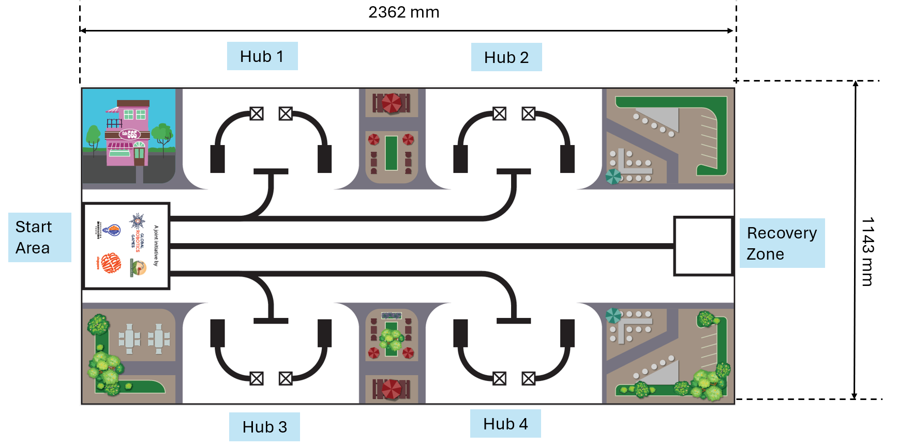
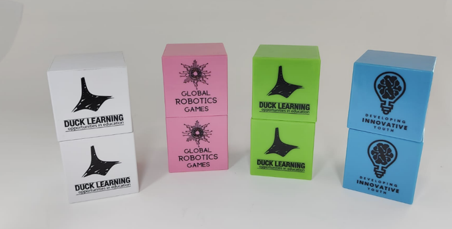
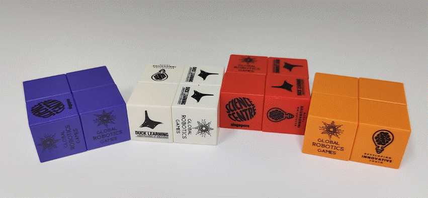
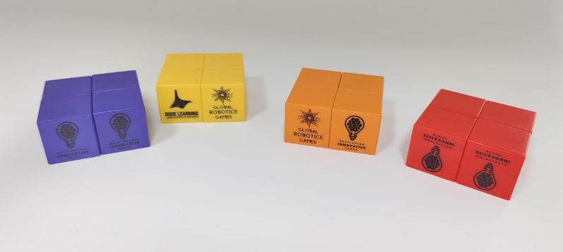
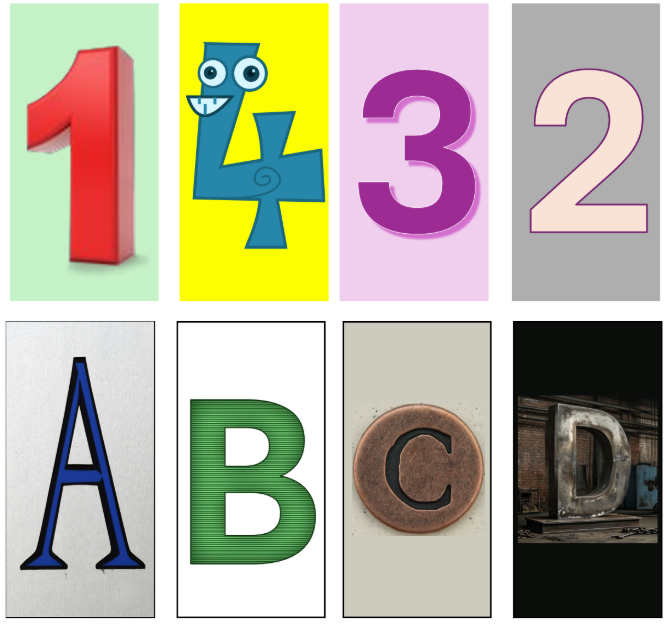
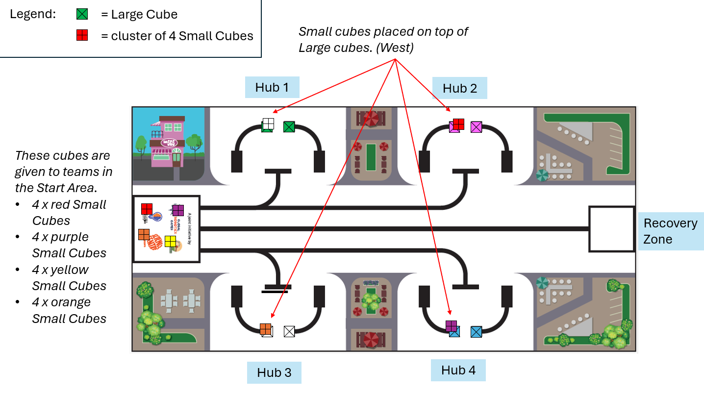
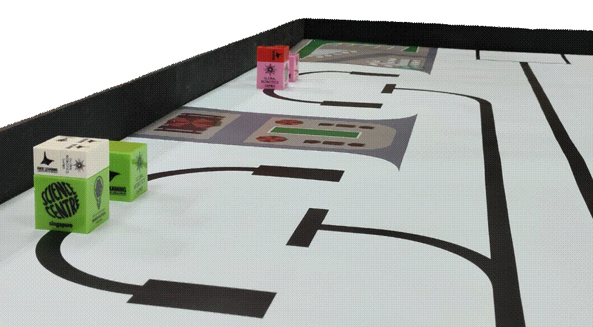
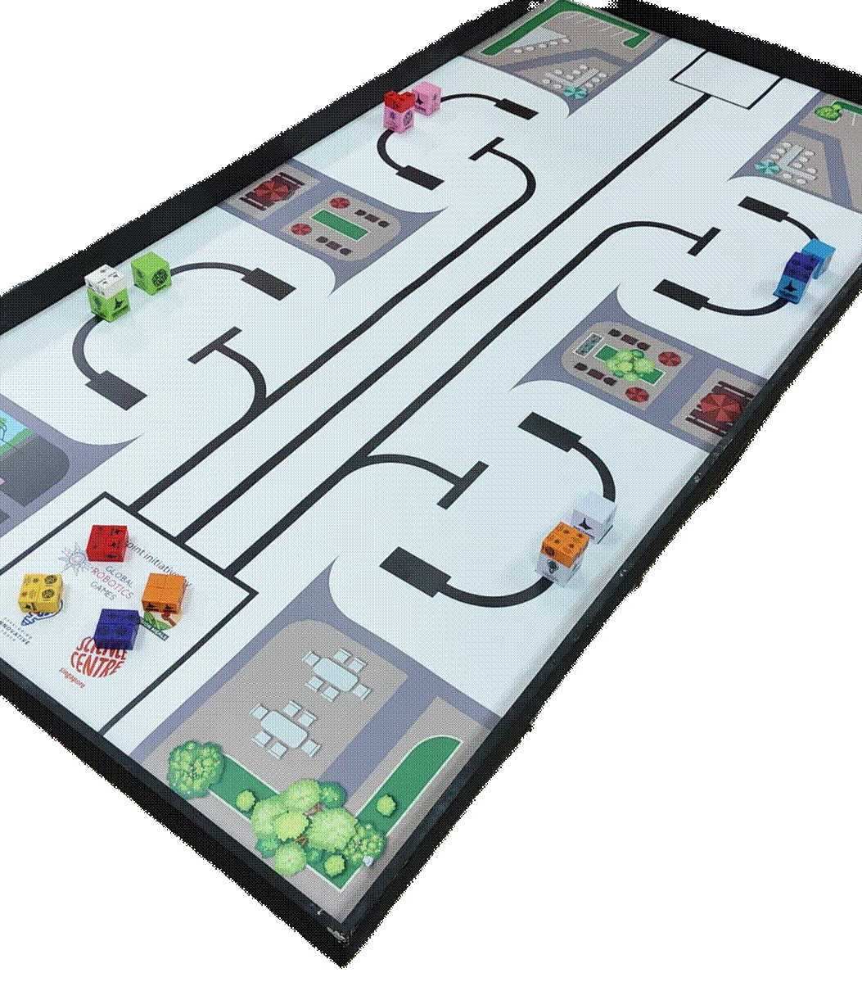
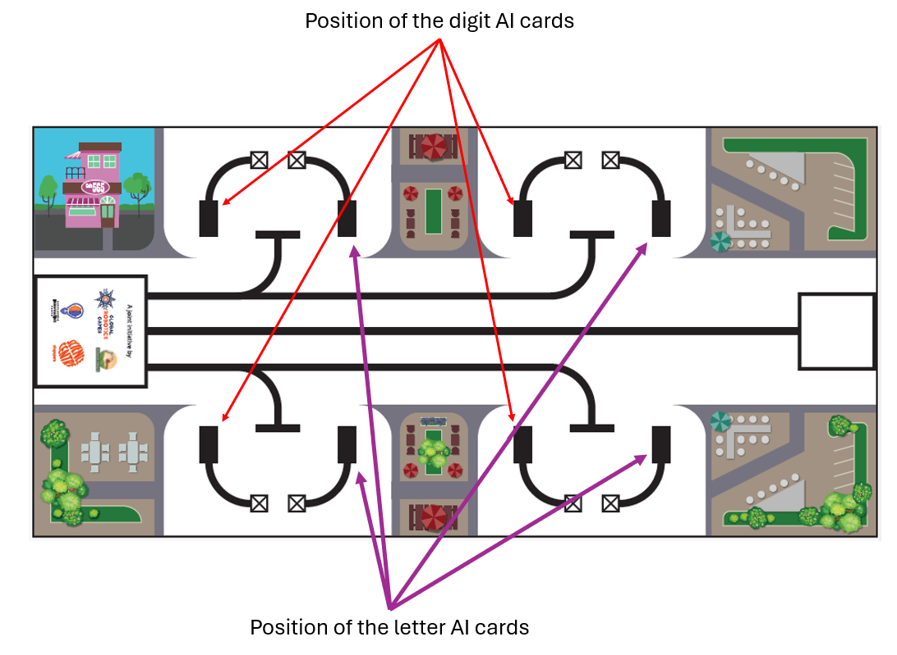
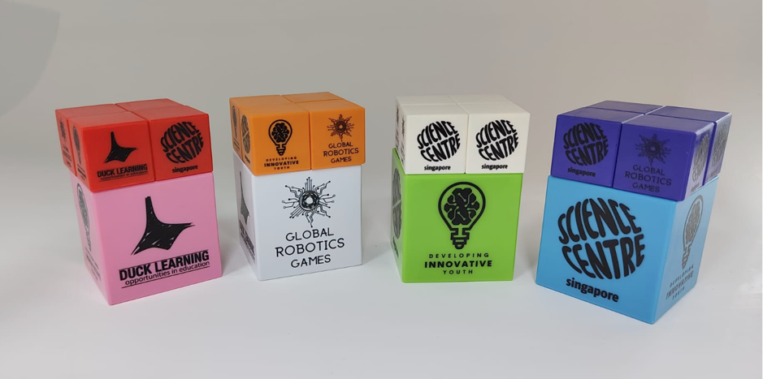

# 2026 GRG Mobile Robotics IV (MR4) Rules - Original English Version

> [!IMPORTANT]  
> This is the exact verbatim original English rulebook as provided by the official Global Robotics Games. Checked chapter by chapter against the organizer's Quacktolearn online version on 2026-11-10.

## 1. INTRODUCTION

The 2026 Mobile Robotics IV challenge, Mission Meals, is deeply rooted in the global mission to realize the United Nations Sustainable Development Goal #2, which aims to achieve Zero Hunger.
This goal is a universal call to action to end hunger, achieve food security, improve nutrition, and promote sustainable agriculture across all nations.
While traditional efforts often focus solely on the production of more food, this challenge highlights that true food security is impossible without addressing the systemic inefficiencies in how we consume and manage our existing resources.
Poverty and hunger remain intertwined global challenges, often exacerbated by a lack of access to basic necessities and the infrastructure required to manage resources effectively.
In many modern urban environments, a paradoxical situation exists where millions of people face chronic food insecurity despite the presence of a vast surplus of organic materials and bio-waste.
By reimagining this waste [1] not as a burden but as a vital resource, we can develop innovative solutions to bridge the gap between waste and want.
The Mission Meals challenge focuses on the collection and conversion of organic bio-waste into nutrient-rich foundations for urban farming initiatives.
This process creates a sustainable circular economy [2] that can stabilize local food supplies, particularly for impoverished communities where access to fresh, nutritious food is often limited.
This year's competition encourages participants to apply advanced robotics and engineering skills to tackle these critical issues of resource recovery and food stability.
Each specific task within the challenge represents a real-world scenario where autonomous technology can make a meaningful, positive difference in the lives of vulnerable populations.
By deploying robots to handle the logistics of waste management, we simulate a future where technology assists communities in overcoming barriers to growth and equity.

The challenge tasks the robot with serving as an autonomous recovery and processing unit, responsible for the audit, purification, and fortification of organic materials.
Through these actions, students demonstrate how robotics can be used to facilitate the distribution of essential needs and support the livelihoods of those in need.
By aligning their technical innovations with the vision of SDG #2, participants learn about the broader social and economic impacts of their work, empowering them to become problem-solvers who contribute to a future where technology helps create opportunity and sustainable communities for everyone.

**References:**
[1] https://www.unep.org/news-and-stories/speech/reducing-food-waste-multi-purpose-solution-climate-and-economic-health
[2] https://www.ellenmacarthurfoundation.org/topics/circular-economy-introduction/overview

---

## 2. GUIDE TO READING THE CHALLENGE DOCUMENT

Here is a guide that you can follow to understand how the robot-game's document has been organized.
**Step 1: Read the Introduction.** This gives you an outline of the situation in the world today based on the theme.
**Step 2: Glance through the Game Field.** This is the playfield on which your robot will run. It shows you the placement of the missions. Importantly, note that the playfield is oriented with directions of the compass. There is a North, South, East and West. For E.G. The Start Area is in the west.
**Step 3: Understand the missions.** As you go through the missions, refer to the game field. Some missions are static, whereas some are movable mission props. Importantly, know the scores you get for each mission and understand the scoring criteria carefully.
**Step 4: Read the Rules for the do’s and dont’s.** There are times when you can touch your robot, robot-equipment and and times when you cannot. Understand them well.
That’s it! This was a simple guide to get you started in your Global Robotics Games journey.
HAVE FUN READING AND CODING!

---

## 3. GAME FIELD

### 3.1 Orientation of the playfield
The 2026 playfield is a complex logistical landscape featuring several distinct operational areas and functional zones.
To ensure navigational precision and clear communication between teams and referees, these areas are differentiated with respect to a standard compass orientation.
This system mirrors the methodology used in nautical charts and topographical maps, where a compass rose is traditionally utilized to help operators orient themselves against specific landmarks.
While a physical compass rose is not printed directly on the mat surface, teams must orient their strategic planning by assuming a central compass exists in the geographical center of the playfield.
This orientation is critical for programming autonomous movements and understanding the relative positioning of the mission objectives.
The playfield is oriented using a central compass:
- **West:** The Start Area.
- **East:** The Recovery Zone (The central processing facility).
- **Central Field:** Four Urban Commercial Hubs (Collection points for raw bio-waste).

### 3.2 Start Area and Loading Bay
**Start Area**
There is only one start area. Before the start of the run, the robot must fit completely in the start area.
The Start Area is considered to be a volumetric box of size **250mm X 250mm X 250mm**.
The surrounding line is not included in the start area. Cables must be included in these dimensions.
After the Robot has started, the dimensions of the robot are not restricted.

After the match begins, the Start Area becomes the Loading Bay.
The Loading Bay is a 2-dimensional space on the playfield.
Which means that only what is touching inside the Loading Bay will be considered and not what is hovering above it.
In this space, teams are allowed to touch their robot, robot-equipment and some of the playfield elements.
Specific rules regarding what is allowed or not allowed in this space is mentioned in the Sub-Category Game Rules section below.

---

## 4. GAME OBJECTS, POSITIONING, RANDOMISATION

The following table outlines the mission props and their details:

| MISSION PROPS | POSITION AND NOTES |
| --- | --- |
| **Large Cubes (8)** | 8 x Large Cubes to be used. There are 4 colours: 2 x Pink, 2 x Green, 2 x Blue and 2 x White.   |
| **Small Cubes (16)** | These are the set of small cubes that will be placed on top of a Large Cube for Mission 1.  4 x Purple, 4 x White, 4 x Red, 4 x Orange.   |
| **Small Cubes (16)** | 4 x Purple, 4 x Yellow, 4 x Orange, 4 x Red. Start on the robot.   |
| **AI cards** | There are eight AI cards. They represent the numbers 1, 2, 3, and 4, and letters A, B, C, and D. *Final design is subject to change. These images can be printed by the team. Refer to the A4 sheet in the course.   |

*Note: Images provided in the challenge document are for representation. Final mission prop designs and AI card visuals are subject to the official kit and course updates.*

**Starting position of the Cubes and the AI cards:**

**Example of Green Large Cubes in Hub 1 and Pink Large Cubes in Hub 2:**

**Placement of all the cubes for 4 hubs and Start Area:**

**Placement of AI cards:**

---

## 5. ROBOT MISSIONS

"The following missions represent the journey of organic waste from urban collection to high-value nutrient recovery, Mission Meals. Scoring is based strictly on the Final State of the field when the 120-second match ends or when the team signifies a stop."

The overall objective is to create an Integrated Bio-Stack through two critical recovery missions.

### 5.1 Mission 1: Logistical Vertical Stacking

**The objective:**
The objective of this mission is the structural assembly of a centralized bio-waste repository within the designated Recovery Zone.
This task simulates the industrial consolidation of stabilized organic matter into a singular, high-density vertical tower to optimize space and processing efficiency within an urban processing facility.
It is important to note that the scoring for this mission is contingent upon the structural integrity and singularity of the build.
Points are awarded exclusively for Large Cubes and the accompanying small cubes, that are integrated into a single, vertical tower at the conclusion of the match.

**Scoring specifications:**
Referees are instructed to identify and score only one tower per run; any Large Cubes that have been delivered to the Recovery Zone but remain isolated, unstacked, or part of a secondary stack will be ineligible for points and recorded with a score of zero.
*A secondary stack is a stack with the lowest combination of points. The referee will decide which stack in the Recovery Zone to score.*

**The Task:**
Each of the four Hubs contains a Primary Large Cube with four Small Cubes already placed on its top surface.

| Large cube | Corresponding Small Cubes |
| --- | --- |
| Green x 1 | White x 4 |
| Pink x 1 | Red x 4 |
| Blue x 1 | Purple x 4 |
| White x 1 | Orange x 4 |

*Image showing the Large Cube and the corresponding Small Cube sets.*

The robot must identify the Digit Card (1–4) at the Hub to determine the cube’s position in the final tower.
**Mandatory AI Detection:** The robot must identify the Digit Card (1–4) at the Hub to determine the cube’s position in the final tower. Note: This identification must be performed exclusively through AI-based computer vision models; the use of simple color or distance sensors for card differentiation is strictly prohibited.
The robot must transport these Primary Large Cubes to the Recovery Zone (East) together with the small cubes already placed on top of its surface.
The robot must stack the cubes in a single vertical column: '1' at the base, '2' second layer, '3' third layer, and '4' at the summit.

**SCORING REQUIREMENTS**
| Criteria | Points |
| --- | --- |
| **Tower Integration:** Each Large cube and accompanying small cube stack integrated into a single vertical tower in the Recovery Zone. | 5 points per Large Cube & accompanying small cubes |
| **Stacking Integrity:** Each Large Cube and accompanying small cube stack placed in the correct numerical sequence (1 at base, 4 at top). | 20 points per Large cube & accompanying small cubes |

### 5.2 Mission 2: Nutrient Injection (onsite fortification)

**Objective:** To fortify a second, empty batch of waste at the Hub using specific nutrient additives carried by the robot.

**The Task:**
- Each Hub contains a Secondary Large Cube (empty).
- The robot carries an onboard inventory of 16 Small Cubes (4 of each colour: Red, Purple, Yellow, Orange).
- The robot must read the Letter Card (A–D) at the Hub.
  - *Note: To ensure technical rigor, only AI-driven recognition models are permitted to interpret Letter Cards. Failure to use an AI model for this task will result in a score of zero for the Hub.*
- The robot must dispense/place four Small Cubes of the matching colour onto the Secondary Large Cube.
- **Nutrient Mapping Guide:**
  - **A:** 4 Red Small Cubes.
  - **B:** 4 Purple Small Cubes.
  - **C:** 4 Yellow Small Cubes.
  - **D:** 4 Orange Small Cubes.

**Scoring Requirements**
| Criteria | Points |
| --- | --- |
| **Random Fortification:** Secondary Large Cube has any 4 coloured cubes placed on it at the end of the match. **Location constraint:** The Secondary Large Cube must remain completely within its original Hub square to score. | 5 points per Large Cube & small cubes |
| **Successful Fortification:** Secondary Large Cube has the correct 4 matching Small Cubes placed on it at the end of the match. **Location constraint:** The Secondary Large Cube must remain completely within its original Hub square to score. | 20 points per Large cube & small cubes |

---

## 6. SUB-CATEGORY GAME RULES

### 6.1 Pre-Run
- The robot will be inspected by referees according to the requirements prior to quarantine.
- The team’s robot and robot-equipment must fit within a space of **250mm X 250mm X 250mm**.
- **AI Validation:** During inspection, teams must declare the specific AI model or framework used for card detection. Referees may request a brief demonstration or code verification to ensure no non-AI shortcuts (such as color-thresholding or mechanical triggers) are being used to "read" the cards.
- Failing to show the use of AI to detect cards will result in that run being forfeited.
- Teams will be asked to place their robot and robot-equipment in the Start Area during inspection.
- Robot, robot-equipment, and the 16 Small Cubes for Mission 2 must be loaded on the robot in the Start Area.
- Teams will then be asked to roll a die. The number of the die represents how the cards will be placed in the 4 hubs.
- First teams will roll the die multiple times to determine the cards to be placed for hub 1, then hub 2, hub 3 and lastly hub 4.
- The first roll is to determine the number card. The second roll is the letter card.
- Hub 1 cards are placed before moving on to Hub 2.

| Number on die | AI number card |
| --- | --- |
| 1 | 1 |
| 2 | 2 |
| 3 | 3 |
| 4 | 4 |
| 5 or 6 | Roll again |

| Number on die | AI letter card |
| --- | --- |
| 1 | A |
| 2 | B |
| 3 | C |
| 4 | D |
| 5 or 6 | Roll again |

- Teams are not allowed to store any part or attachments off the field to be introduced during the match (e.g. holding on to ‘LEGO jigs’ by hand).
- Teams are not allowed to enter data to a program by changing positions or orientation of the robot parts or to make any sensor calibrations of the robot.
- Teams are allowed to adjust the robot by hand only in the Start Area.
- All wireless communication capabilities in the robot-hub have to be turned off; Bluetooth and wifi must be disabled.
- Unless it is needed to run the AI model, in which case teams must show that wireless communication is only used to connect the robot to the computer to run the AI model if needed.
- Wireless communication cannot be used to send any instructions of movement (motor control) to the robot.

### 6.2 Start of a Match
- Time begins when the referee gives the signal to start.
- The referee will give a command: “G. R. G. Go!” (or any other signal the Referee chooses)
- Each robot match is a maximum of 2:00 minutes long (120 seconds).
- After 120 seconds, the referee will not consider any points that the robot gains.

### 6.3 During Robot Run
**The Single Batch Rule:** The robot is permitted to bring into the Start Area only one Large Cube at any one point in time. (There is no restriction on the number of small cubes allowed in the Start Area.)
**Referee Enforcement:** If there are more than one Large Cubes in the Start Area, the referee will confiscate all but one Large Cubes at random and those large cubes will be considered out-of-play.

When the robot or robot-equipment comes to a complete stop fully within the Start Area, teams are allowed:
- To touch and reposition the robot within the Start Area.
- To switch programs in their robot.
- To unload/move/touch any of the mission props and/or robot-equipment from the robot by hand.
- To load mission props by hand from the Start Area onto the robot.
- To reposition their robot to move off from the Start Area.

**Teams are not allowed:**
- To touch the robot when the robot is moving on the playfield.
- To touch any robot-equipment or mission props outside the Start Area when the robot is moving.
- To reprogram and enter data into the robot during robot run.
- To score any missions while the robot is within the Start Area.

### 6.4 Ending of Robot Run
A robot attempt will end if:
- The 2 minutes mark is up (120 seconds).
- The robot has completely left the game table.
- The robot or team has violated the rules or regulations.
- A team member shouts “STOP”, and the robot does not move anymore.

After the robot-run, the referee will score the attempt.
Teams are required to sign off on the scores on the scoring sheet; once signed, no further changes are possible.
It is not allowed for a coach to join the discussion with Referees on the scoring; video or photo proofs will not be accepted.
If no missions yielding positive points are solved, the run time will be set at 120 seconds.

---

## 7. Scoring

**7. MISSION SCORING MATRIX**

| TASK DESCRIPTION | POINTS (P) | QUANTITY (Q) | MAX (P X Q) |
| --- | --- | --- | --- |
| **5.1 Logistical Vertical Stacking** | | | |
| **Tower Integration:** Large Cube and accompanying small cube stack integrated into a single vertical tower in the Recovery Zone. | 5 | # of stacks: ____ | 100 |
| **Stacking Integrity:** Large Cube and accompanying small cube stack placed in the correct numerical sequence (1 at base, 4 at top). | 20 | # of stacks: ____ | |
| **5.2 Nutrient Injection** | | | |
| **Successful Fortification:** Secondary Large Cube has the correct 4 matching Small Cubes placed on it at the end of the match. **Location:** Must remain completely within its original Hub square. | 20 | # of hubs: ____ | 100 |
| **Random Fortification:** Secondary Large Cube has any 4 coloured cubes placed on it at the end of the match. **Location:** Must remain completely within its original Hub square. | 5 | # of hubs: ____ | |
| **AGGREGATE MAXIMUM SCORE** | | | **200 Points** |

## 8. Scoring Interpretations
Scoring Interpretations can be found in pdf in the Challenge Document section.
